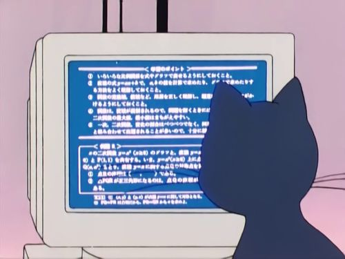

<div align="center">

# · · ─ ·𖥸· ─ · · 
# hi! i'm Aaraghya ⊹ ࣪ ˖

<div align="center">

<p align="center">
  <code>turning coffee into commits ⋆☕︎˖</code>
</p>



</div>

</div>

---

## ⚡︎ experience

```bash

$ Projects ˎˊ˗

├── Orchestrix
├── Schrödinger's Gambit 
├── Liminal
└── SkillSync

$ Community Work ˎˊ˗

├── Events Team - Google Developer Groups
└── Organizing Team - HackSRM 7.0

```
---
## °‧ 𓆝 the commit stream
<div align="center">
  
</div>

---
## 
<div align="center">


</div>

---
## ٠࣪⭑ curious?
<div align="center">
  <a href="./assets/Aaraghya_Bhatnagar_CV.pdf">
    
  </a>
</div>

---
⁠♡ thanks 4 visiting :) 
